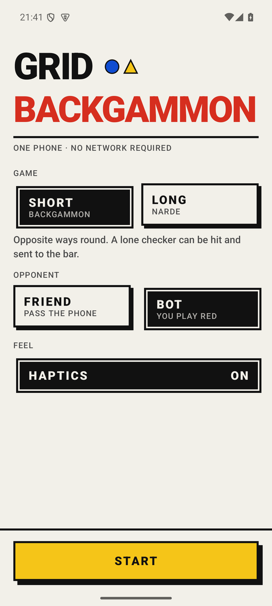
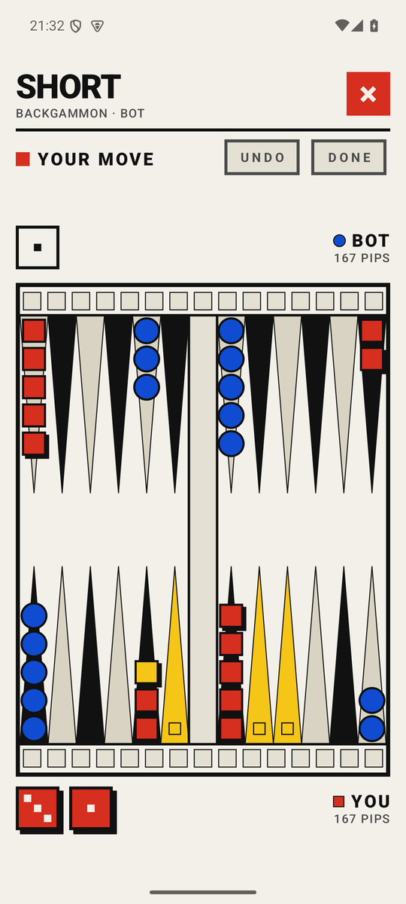
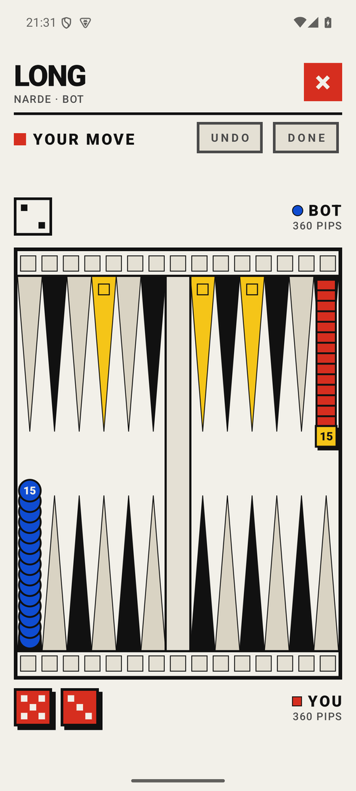

<h1>GRID BACKGAMMON</h1>

Backgammon, short and long, for two on one phone or against a bot. The app has no internet permission.

<p>
  <a href="../../releases/latest"></a>
  
  
</p>

<table>
  <tr>
    <td></td>
    <td></td>
    <td></td>
  </tr>
  <tr>
    <td align="center"><sub>Two games, one board</sub></td>
    <td align="center"><sub>Where it can go is lit</sub></td>
    <td align="center"><sub>One off the head per turn</sub></td>
  </tr>
</table>

## Rules

**Short** is backgammon: the sides run opposite ways, a lone checker can be hit and re-enters from the bar. Gammon counts 2, backgammon 3.

**Long** is narde: both sides run the same way from a head of fifteen. One checker holds a point and nothing is hit. One checker leaves the head per turn, two on a first 6-6, 4-4 or 3-3. A wall of six is allowed only once a checker of the other side is past it. Mars counts 2.

In both, the higher opening die starts, and as much of the throw as possible must be played, the larger die if only one fits. No doubling cube.

Tap a checker, then where it goes. A checker with one place to go moves straight away. Undo works until you press Done.

## Design

It looks like [GRID CHESS](https://github.com/solidens/grid-chess) and [GRID LUDO](https://github.com/solidens/grid-ludo). Red plays squares, blue plays circles; yellow marks where a checker can go.

The bot scores every way to play its throw, then checks the best six against all 21 replies.

## Build

```bash
brew install openjdk@21
brew install --cask android-commandlinetools
./gradlew :app:assembleDebug
```

Release signing reads `keystore.properties` from the project root.

## Licence

GPL-3.0. See [LICENSE](LICENSE) and [NOTICE](NOTICE).
